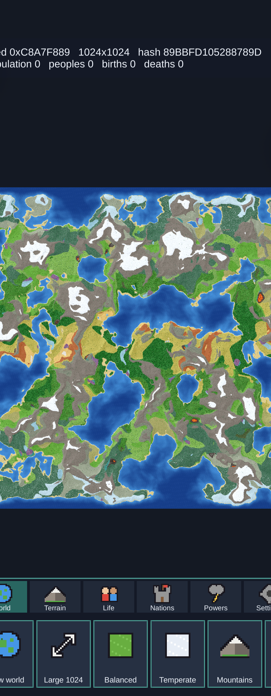
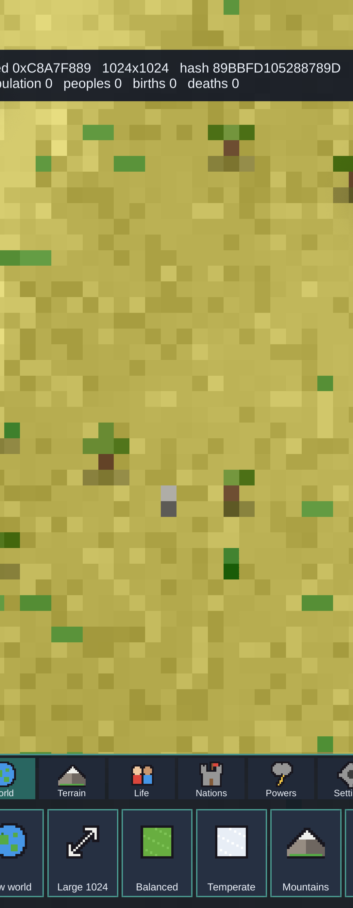
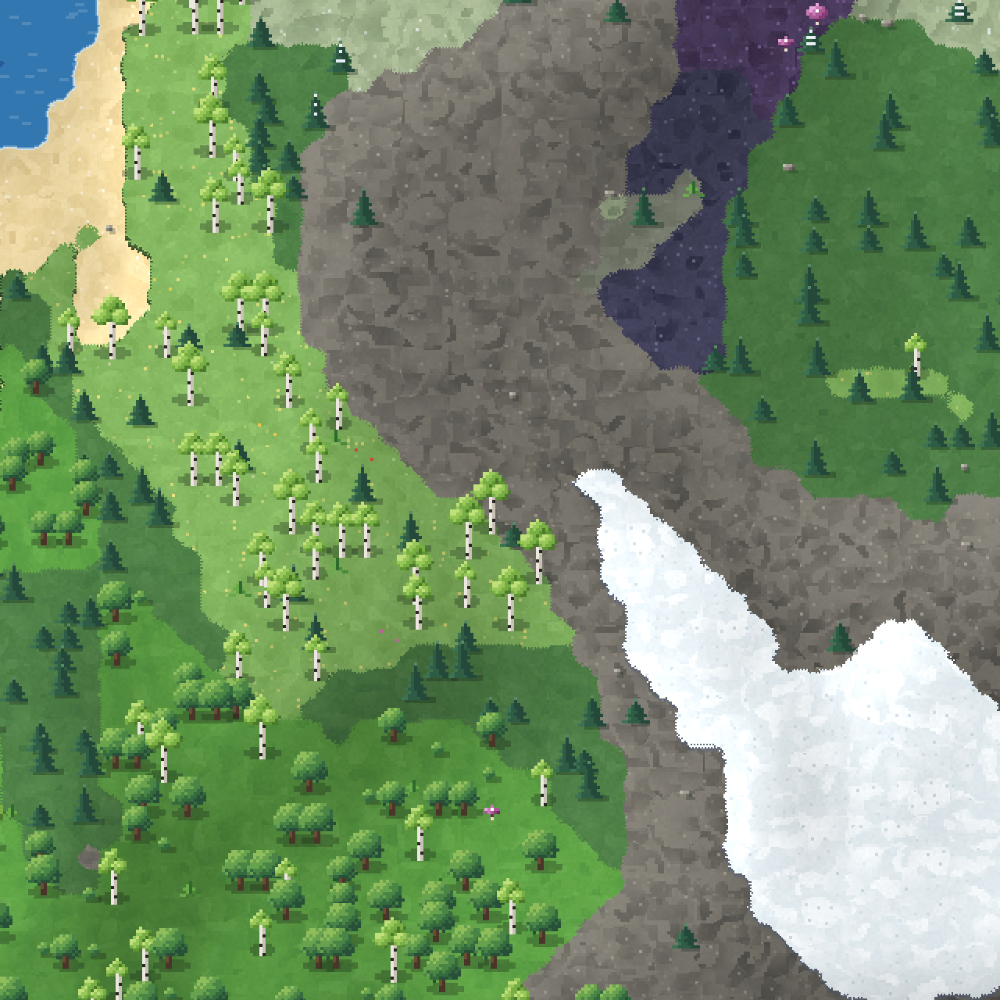
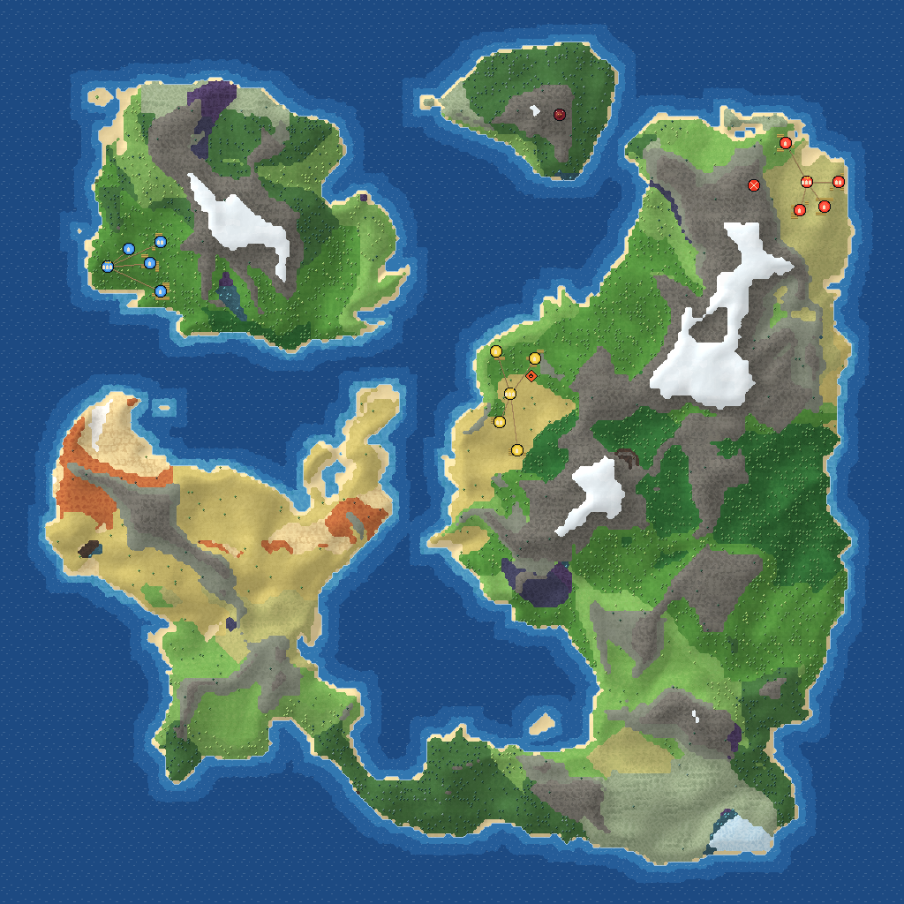

# WorldSim: project status report

Date: 2026-11-21. Written for a course-correction review. No code was changed to write it.

**Legend.** "Verified" means checked by a test, a CI run or the owner's phone (the evidence is named). "Not verified" means it was not checked or the check isn't recorded; nothing here is guessed.

**State in one paragraph.** The deterministic core (world generation, world editing, life simulation core) and the CI pipeline are solid and tested. The owner-generated art pack (36 atlases, 237 audio clips, data JSON) is in the repo with a lazy loader, R8 masks and a partial-ASTC import rule. The game itself still draws the world with the **old procedural painter**, which the owner rejected. The new look exists only as a pure C# reference renderer used by the preview tool; the Unity renderer for it has not been started. Civilizations, powers, eras, weather, audio playback and save/load do not exist in the game yet.

---

## 1. Branches and commits

Remote: `origin` = github.com/Flux-Egy/WorldSim (public). `main` has 51 commits.

| Branch | Last commit | Date | Merged into main? |
|---|---|---|---|
| `main` | `d337695` Merge branch 'art/r8-masks': one-byte recolour masks (lossless) | 2026-11-20 | (is main) |
| `rebuild/pack-foundation` | `af635c8` Terrain renderer v2 (owner review): smooth borders, continuous cliffs, no repeats | 2026-11-21 | **No**: 7 commits ahead of main (by design: main stays untouched until the owner approves the rebuild) |
| `art/astc-test` | `30f78df` ASTC experiment: colour pages ASTC 4x4 on Android | 2026-11-20 | **No**: 2 commits ahead (`6f96118` Art Lab, `30f78df` all-ASTC experiment). Superseded: the Art Lab commit was cherry-picked into `rebuild/pack-foundation` and the owner chose *partial* ASTC there |
| `art/pack-v3.1` | `489aeee` Art pack patch v3.1.1 (event frames) + audio audition results | 2026-11-20 | Yes (`235d7a5`) |
| `art/r8-masks` | `c4c2a7d` Recolour masks: one byte per pixel | 2026-11-20 | Yes (`d337695`) |
| `wip/b4-other-agent` (**local only, never pushed**) | `987305c` WIP (other agent): partial Beta B4 civilizations, not built | 2026-11-18 | No. 7 files, +927 lines: `Core/Civ/AStarGrid.cs`, `CivNames.cs`, `CivRules.cs`, `Simulation/Civ/CivComponents.cs`, Life changes, `CivCoreTests.cs`. **Never compiled in Unity, never reviewed** |

`rebuild/pack-foundation` commits (oldest first):
1. `34a3a46` Art patch v3.4.1: the 4 extra sim biomes + far-zoom (LOD) art
2. `ebdcd3c` Art Lab: fixed-camera sprite grid for pixel-exact build comparisons
3. `ba5e026` Partial ASTC (owner decision) + texture-format-aware memory accounting
4. `fb2dd12` Rebuild phase 1a: the pack's 24 biomes + Lava/Birch/Glimmerwood/Ember + water
5. `daec033` Rebuild phase 1b: species -> pack creatures (4 peoples + the 9 life species)
6. `38fb7fd` Rebuild: cleaner world generation + new pack terrain renderer (CPU reference)
7. `af635c8` Terrain renderer v2 (owner review): smooth borders, continuous cliffs, no repeats

**Uncommitted work** (on the phone's checkout of `rebuild/pack-foundation`, not pushed): terrain renderer **v3**, which follows the owner's latest decision (no terraces, soft hillshade, coast-only cliff, blue-grey shadow south of snow, white foam line, smooth water bands, far-zoom markers/roads/farms overlay with demo kingdoms). Files: `Render/Terrain/TerrainComposer.cs`, `TerrainField.cs`, `TerrainLayout.cs`, new `FarOverlay.cs`, `Tests/EditMode/TerrainLayoutTests.cs`, new `FarOverlayTests.cs`, `Tools/WorldPreview/PackPreview.cs`. The project was paused just before committing it.

## 2. Architecture

### Folders (`Assets/WorldSim/`)

| Path | Assembly | What it does |
|---|---|---|
| `Runtime/Core` | `WorldSim.Core` (pure C#, no Unity) | Deterministic math and world: `SplitMix64`, `Pcg32`, `StableHash64`, `WorldSeed`, `FixedNoise` (fixed-point noise), `TileData` (biome, height, moisture, temperature, resources, decoration), `WorldGenerator` (climate table, anomalies, decoration scatter, resources, world hash), `WorldEditor` (brush edits) |
| `Runtime/Core/Life` | `WorldSim.Core` | `Species` (13 built-in species and stats), `Traits` (trait sets and inheritance), `NameGenerator` |
| `Runtime/Render` | `WorldSim.Render` (pure C#) | Old procedural painters: `TerrainPainter`, `SpriteLibrary` (decorations), `CreatureSprites`, `IconLibrary`, plus `PngDecoder` and `Rgba` |
| `Runtime/Render/Art` | `WorldSim.Render` | `ArtIndex` (binary art index parser), `BiomeArt` (biome/decoration -> pack frame names), `CreatureArt` (species/pose -> pack animation names) |
| `Runtime/Render/Terrain` | `WorldSim.Render` | New-look CPU reference renderer: `TerrainLayout` (per-cell classes, water distance, smoothed height), `TerrainField` (per-pixel smooth borders), `TerrainComposer` (near/far compositing). Only the preview tool and tests use it |
| `Runtime/Simulation` | `WorldSim.Simulation` (DOTS) | `SimulationTickGroup` (10 Hz clock), `WorldMapSystem` (parallel world generation + hash), `TerrainEditSystem` (applies brush edits) |
| `Runtime/Simulation/Life` | `WorldSim.Simulation` | `LifeComponents` (Creature, Mover, Vitals, needs, actions), `LifeSystems` (`CreatureSpawnSystem`, `LifeSimSystem`: needs, utility actions, movement, birth, death) |
| `Runtime/Presentation` | `WorldSim.Presentation` (MonoBehaviour) | `WorldSimBootstrap` (boot), `WorldViewController` (wires world, camera, input, HUD), `CameraRig`, `Input/GestureRecognizer`, `Terrain/TerrainTexture` + `TerrainView` (old terrain on screen), `Life/CreatureView` (creature sprites), `UI/WorldHud` (uGUI built in code) |
| `Runtime/Presentation/Art` | `WorldSim.Presentation` | `WorldSimArtDB` (lazy pack loader: index at boot, pages and masks on demand, safe `Release`), `WorldSimRecolor` + shader (kingdom recolour, burn/frost/overgrown states), `WorldSimPalette` (ramp textures), `WorldSimAudioDB` (clip lookup), `ArtTestView` and `ArtLabView` (developer screens) |
| `Runtime/ModAPI`, `Runtime/Modding` | own assemblies | Version constant and build flag only (mods not started) |
| `Editor` | `WorldSim.Editor` | `WorldSimCI` (headless bootstrap), `WorldSimBuild` (Android build), `WorldSimProjectSetup`, `GameCIReporter`, `WorldSimArtPostprocessor` (point filter, R8 masks, partial ASTC) |
| `Resources/WorldSimArt` | data | 36 atlases (PNG + JSON + masks), `art_index.bytes`, `mask_lut.png`, recolour shader |
| `Resources/WorldSimAudio` | data | 237 OGG clips (Ambient, Music, SFX) + `audio_index.json` |
| `Resources/WorldSimData` | data | creatures, culture rules, interactions, kingdom palettes, life and powers, world rules, LOD, army roster, animation events, feature backlog (JSON) |
| `Tests/EditMode` | `WorldSim.Tests.EditMode` | Pure tests (run in plain .NET on the phone and in Unity CI) |
| `Tests/Unity` | `WorldSim.Tests.Unity` | Unity-only tests (art loader, compression rule) |

Tools outside `Assets`: `Tools/CoreTests` (dotnet test project), `Tools/WorldPreview` (renders worlds to PNG; `pack` mode = new look), `Tools/ArtIndex` (index builder and mask encoder, with `--check` in CI), `Tools/ArtGen` (the art pack's generators), `Tools/Unity` (codespace scripts), `ci/` (meta check, test keystore).

### DOTS/ECS vs MonoBehaviour

- **ECS (ISystem, Burst jobs):** world generation and hashing (`WorldMapSystem`), terrain edits (`TerrainEditSystem`), simulation clock, life (`CreatureSpawnSystem`, `LifeSimSystem`). The old terrain texture painting also runs in jobs (`TerrainTexture`: IJob/IJobParallelFor).
- **MonoBehaviour / plain classes:** everything on screen and all input: bootstrap, view controller, camera, gestures, HUD, creature view (SpriteRenderer pool), art loader, recolour, Art test/Lab screens.
- **Pure C# (no Unity):** Core and Render. These are tested on the phone in seconds.

## 3. Systems status

Columns: **Exists?** (code present) / **Works?** (does what it should) / **Tested where** / **Has tests?**

| System | Exists? | Works? | Tested where | Has tests? |
|---|---|---|---|---|
| **World generation** | Yes. Main: 19 biomes. Rebuild branch: 30 (pack's 24 + Lava, BirchForest, Glimmerwood, EmberWastes + deep/shallow water), larger regions, snow only on peaks, fewer decorations | Yes | .NET golden hashes; device hash match verified for the **old** generator (Stage 2). The rebuild-branch generator on device: **not verified** | Yes (`WorldGenTests`, `CoreDeterminismTests`) |
| **Map renderer: old** (`TerrainPainter`/`TerrainTexture`/`TerrainView`) | Yes, used by the game on all branches | Works, but the **owner rejected the look** | Device (B1/Stage 2) | Yes (`RenderTests`) |
| **Map renderer: new C# reference** | Yes (v2 committed, v3 uncommitted) | Yes, in the preview tool only. Seconds per map: not a runtime renderer | Phone, images checked by eye and by the owner | Yes (`TerrainLayoutTests`, `FarOverlayTests` uncommitted) |
| **Map renderer: Unity shader** | **No** | n/a | n/a | No |
| **LOD / zoom** | Old: zoom-dependent detail (B1 part 3) in game. New: far 1/4 and 1/8 with LOD tiles in the C# reference only. Pixel-perfect integer zoom and the 4 levels of `lod.json` in the game: **No** | Old: yes. New: preview only | Old: device (B1). Pinch/pan on device: **pending owner check since Stage 3** | Gestures: yes (`GestureRecognizerTests`) |
| **Agents, needs, jobs** | Needs (hunger, thirst, fatigue), utility actions (idle, wander, eat, drink, sleep, flee, hunt, mate), traits with inheritance, birth/aging/death. **No jobs/work** (gather, build, farm) | Core logic yes | .NET (core only). On device: **not verified** (no recorded check of creatures on screen) | Yes (`LifeCoreTests`), ECS systems have no tests |
| **Settlements and buildings** | **No** (only art). Partial civ code exists on the unpushed `wip/b4-other-agent` branch | No | n/a | Only in the WIP branch, never run |
| **Kingdoms, culture, borders, war** | **No** (art, palettes and data JSON only; demo kingdoms in the preview are fake) | No | n/a | No |
| **Creatures, monsters, titans, magic** | 13 species in the simulation; `CreatureArt` maps them to pack animations (preview/tests only, the game still draws the old procedural creatures). 174 pack creatures, titans and magic beings: art and JSON only | Mapping yes; game: old sprites | .NET | Yes (`CreatureArtTests`: 2,496 names resolved) |
| **Powers, disasters, blast zones, building states** | **No** in the simulation. The recolour shader has burn/frost/overgrown states; disaster art exists | No | n/a | No |
| **Eras, seasons, weather** | **No** (seasonal tiles, era buildings and weather FX exist as art) | No | n/a | No |
| **Audio** | 237 clips (owner-approved) + `WorldSimAudioDB` lookup. **Nothing plays them**; the import postprocessor (phase 6) is not done | No | Clips audited offline (peaks, no clipping) | No |
| **UI and input** | Old HUD (uGUI built in code: tabs, terrain palette, settings, Art test/Art lab buttons, debug text) + gestures + camera. New UI from `ui_kit`: **No** | Old HUD works | Device (taps); pinch/pan/long-press: pending owner check | Gestures yes; HUD no |
| **Save / load** | **No** (only the last seed in PlayerPrefs) | No | n/a | No |
| **Art loader** (`WorldSimArtDB`) | Yes | Yes | Device: 0 MiB at boot, 25 MiB with the Art test scene (R8 masks), back to 0 after Release; CI Unity tests | Yes (`ArtDBLoadingTests`, `ArtIndexTests`) |
| **Texture import rule** (partial ASTC) | Yes (rebuild branch) | Yes | Device A/B (Art Lab) before the decision; the partial rule itself on device: **not verified** | Yes (`ArtCompressionRuleTests`) |

## 4. Art integration

### Atlases and the code that uses them

"In game" = drawn by the running game. "Mapping" = `BiomeArt`/`CreatureArt` name tables, used today only by tests and the preview tool. "Art Lab" = the developer screen that samples 3 frames of each atlas for build comparisons (not gameplay).

| Atlas | Used by |
|---|---|
| Terrain/terrain_tiles | Mapping (tiles, water, foam), Art Lab |
| Terrain/biomes_extra | Mapping (Lava, Birch, Glimmerwood, Ember tiles and props) |
| Terrain/lod | Mapping (lod16/lod8 tiles); `mk_*` markers in the uncommitted v3 overlay |
| Terrain/terrain_seasonal | Art Lab only (seasonal tiles, blend and shore masks unused) |
| Terrain/farms_roads | Art Lab only |
| Nature/nature_props | Mapping (all decorations), Art Lab |
| Nature/nature_seasonal | Art Lab only |
| Characters/people | **In game: Art test screen only**, Art Lab |
| Characters/People/people_actions | Mapping (4 peoples x 3 eras + children), Art Lab |
| Characters/Fauna/fauna_land, fauna_critters, fauna_sea | Mapping (animals, crow, carp), Art Lab |
| Buildings/houses_culture_kit | **In game: Art test screen only**, Art Lab |
| Characters/animals, Characters/Magic/beings, Characters/Titans/titans | Art Lab only |
| Buildings/buildings_eras, world_structures, Disaster/* (4 atlases) | Art Lab only |
| FX/fx, FX/Spells/spells, FX/Weather/weather_fx, FX/Decals/decals_particles | Art Lab only |
| UI/ui_kit, UI/Icons/icons, UI/Kingdoms/kingdom_colours, UI/font_5x7 | Art Lab only |
| Units/army, Soldiers/soldiers_actions, ships_vehicles, aircraft, air_defence, strategic | Art Lab only |

**Summary:** the game's world view uses **no** pack atlas yet. Pack art appears in the game only on the developer screens (Art test, Art Lab).

### Stand-ins (`BiomeArt.IsStandIn`) and gaps

| Decoration | Stand-in now | Wanted from the art side |
|---|---|---|
| JungleTree | `tree_5_*` | tall rainforest tree |
| AcaciaTree | `tree_3_*` | flat-topped acacia |
| SwampTree | `tree_2_*` | willow / mangrove |
| BerryBush | `bush_*` | bush with berries |
| TallGrass | `fern_*` | grass tuft |

Details: `docs/art/REBUILD_ART_GAPS.md` (rebuild branch). Other gaps:
- The `t_mountain_*` tiles have a visible ~32 px repeat. The renderer hides it (random patches and calmer contrast); a calmer tile would be better.
- `Farmland` and `IrradiatedWaste` biomes are never generated (by design: made by people and strikes); nothing creates them yet.

## 5. Tests and CI

| Suite | Count | Result | Evidence |
|---|---|---|---|
| .NET (`dotnet test Tools/CoreTests`), `rebuild/pack-foundation` committed (`af635c8`) | 72 | 72 passed, 0 failed | phone run, 2026-11-21 |
| .NET, working tree with uncommitted v3 | 73 | 73 passed, 0 failed | phone run, 2026-11-21 |
| Unity EditMode on CI, `af635c8` | 92 | 92/92 passed | run 44836083623, check "Test Results" |
| Unity EditMode on CI, `main` (`d337695`) | 65 | 65/65 passed | run 44791214404 |

CI (`.github/workflows/build.yml`): jobs `core-tests` (meta check, art index `--check`, mask `--check`, .NET tests), `license-check`, `unity-tests`, `build-android` (APK artifact). The last 13 runs all succeeded. One run (`fb2dd12`) shows "cancelled": it was replaced while still **pending** (concurrency group, `cancel-in-progress: false`, so a running Unity step is never cancelled).

## 6. Performance

Measured on the owner's phone (display 1280x2772 @ 120 Hz) on 2026-11-21, with the latest `rebuild/pack-foundation` APK (run 44836083623, `af635c8`). The game booted its default world: Large 1024x1024, seed `0xC8A7F889`, old painter, population 0.

| Measure | Value | How |
|---|---|---|
| FPS, far zoom, idle | 60.1 avg; median frame 16.65 ms; p95 16.65 ms; worst 25.0 ms | SurfaceFlinger `--latency` on the game layer (127 frames) |
| FPS, far zoom, panning | 60.1 avg; p95 16.65 ms; worst 16.7 ms | same, during a 1.8 s pan |
| FPS, max zoom, idle and panning | 60.1 avg; p95 16.65 ms; worst 16.7 ms | same |
| Memory | TOTAL PSS 364 MiB (372,860 KiB); TOTAL RSS 484 MiB; Graphics 49 MiB; EGL mtrack 27 MiB; native heap 26 MiB | `dumpsys meminfo` |
| Draw calls | **Not measured.** Needs a development build with the profiler, or an in-game counter | n/a |

Notes:
- The frame rate sits at 60 FPS: the frame cap holds, though the display can do 120. This is with **no creatures alive** (population 0) and the old painter.
- There is **no measurement yet** with the new renderer, with thousands of agents, or with pack sprites in the world.

Earlier measurements:

| Measure | Value | Evidence |
|---|---|---|
| Art memory, Art test scene | 0 MiB at boot, 25 MiB shown (R8 masks; 40 MiB before), back to 0 after Release; process RSS 233 -> 256 MiB | device logcat, 2026-11-20 |
| All textures, Art Lab (102 frames from 34 atlases) | 233 MiB uncompressed vs 106 MiB all-ASTC. The **partial** ASTC rule's memory on device is **not verified** | device logcat, ASTC A/B |
| New C# reference renderer | ~2-4 s to compose a whole 256 map on the phone CPU (preview tool); not representative of the planned shader | preview tool timing |

## 7. Known problems

1. **The game still shows the rejected look.** The new look lives only in the C# reference; the Unity renderer (shader) has not been started.
2. **v3 renderer uncommitted** (see section 1).
3. **New decorations are invisible in the current game.** On the rebuild branch, Coral, Fern, CharredStump, EmberVent and LavaRock have no sprite in the old `SpriteLibrary`, which only draws the original 23 decorations.
4. **Old procedural creatures** are still drawn in the game. The pack mapping exists, but nothing on screen uses it.
5. Creatures on screen (B3) have **no recorded device check**. The Stage 3 pinch/pan/long-press device check is still pending with the owner.
6. **`wip/b4-other-agent`**: civ code of unknown quality from another agent, local only, never compiled. Decide: review and salvage, or delete.
7. **`art/astc-test`** is superseded; delete it after the review.
8. **The golden world hashes changed 3 times** on the rebuild branch, and will change again with any generation tuning (approved by the owner).
9. **Biome balance:** Salt flats (~0.03-0.1 % of the map), lava and volcanic are very rare; crystal and fungal are intentionally small (~0.2 %).
10. Five decorations use stand-in art (section 4).
11. **Audio is not played anywhere.** Four clips peak above -3 dBFS (an FYI for the art side, not a defect).
12. Pack creature stats in `creatures.json` (hp, damage, speed) are **not** adopted; the simulation keeps its own tuned stats. Pending a balancing decision.
13. **Docs are out of date:** `docs/GAME_VISION_PROMPT.md` (19 biomes, procedural art), `docs/BETA_PLAN.md` (procedural art), `docs/IMPLEMENTATION_PLAN.md`, `docs/ASSET_SPEC.md` predate the art pack and the rebuild. There is **no `docs/DECISIONS.md`**; decisions are spread over CLAUDE.md, the art docs, commit messages and the assistant's private notes (summarised in section 8).
14. **Codespace workshop:** the Remote Control keep-alive and idle-guard tests are not done. The MCP screenshot is 640x480 without the HUD (portrait capture with UI not built).
15. The WorldPreview demo kingdoms are **fake placeholder data**, for showing markers only.
16. **Temporary workarounds:**
    - `PngDecoder` is kept, because the preview tool needs it.
    - The old painter got the new biomes' colours so the branch still runs.
    - `RenderTests` is limited to the first 23 decorations.

## 8. Decisions taken

From CLAUDE.md, `docs/ORIGINALITY.md`, `docs/art/*` and the owner's messages:

| Date | Decision |
|---|---|
| 2026-11-17/18 | Unity 6000.3.28f1, URP 2D, DOTS, Android IL2CPP ARM64; GitHub Actions is the only build server (game-ci v6, CLI v0.1.76); Unity Personal via `UNITY_EMAIL`/`UNITY_PASSWORD` secrets only; never cancel a running Unity step |
| 2026-11-18 | Renamed to WorldSim; **the forbidden-word rule (CLAUDE.md hard rules)**; beliefs fully fictional (procedural creeds); fiction notice on first launch |
| 2026-11-18 | Deterministic simulation (integer/fixed point); golden hashes guard generation |
| 2026-11-18 | Open-ended eras (Stone to beyond), deep editable traits, time control up to 50x, map sizes up to 4096 (plan A1-A5); Beta scope B1-B9 |
| 2026-11-19 | **Originality:** learn from others, never take; no ready-made asset packs; nothing decompiled or ripped (WorldBox included); reference-video frames stay out of the repo |
| 2026-11-19 | Three workshops: phone (pure C#, tests), Actions + device check (Unity side), Codespaces + Unity MCP (planned sessions; MCP never registered on the phone) |
| 2026-11-20 | The owner's generated **art pack is the base art**; no outlines; disaster states via shader + overlays; children die only by fade + grave; jinn/afreet/marid/demon + possession names allowed |
| 2026-11-20 | Lazy loader with a binary index; R8 masks (lossless); all 237 audio clips approved |
| 2026-11-20 | **Rebuild** everything pre-pack on the pack in `rebuild/pack-foundation` (phases 0-8). Main stays untouched until approval. Delete old code only after its replacement works on the phone. Golden hash changes approved |
| 2026-11-20 | Biomes = pack's 24 + Lava, BirchForest, Glimmerwood, EmberWastes + water |
| 2026-11-20 | **Partial ASTC:** terrain (except `Terrain/lod`), nature, buildings incl. disaster, FX. UI, icons, portraits, font, people, animals, units uncompressed. Masks R8, LUT never compressed |
| 2026-11-20 | Phase 4 camera: 4 zoom levels (near, mid, far, map) per `lod.json` |
| 2026-11-21 | Old painter look rejected. Target: reference-video clarity + the pack style demo, own art only. Send a same-seed picture before big visual steps; no merge to main with an unapproved look |
| 2026-11-21 | Renderer review 1: continuous cliffs, no repeats, clean snow, smooth borders and coast, LOD tiles at far zoom, palms only on hot beaches/deserts (done in v2) |
| 2026-11-21 | **Renderer decision 2:** no terraces or contour lines; cliff only at the coast; height through soft hillshade; rock darker/heavier with height; blue-grey shadow south of snow; white foam line; smooth island rims at far zoom; far zoom readable (forest density, `mk_*` markers in kingdom colour, roads, farms). Implement in the C# reference first, then port to Unity after approval (done in v3, uncommitted) |
| 2026-11-21 | Project paused by the owner |

## 9. Screenshots

**In-game, on the owner's phone** (latest `rebuild/pack-foundation` APK, 2026-11-21). Phone overlays at the screen edges are cropped out. The world is drawn by the **old painter**.

- Far (default view, whole Large 1024 map): `docs/status/device_far.png`

  
- Near (maximum zoom, reached with an emulated two-finger pinch): `docs/status/device_near.png`. Each tile is a flat 8 px block scaled up: this is the rejected look.

  

Also visible in these shots:
- The HUD debug line (seed, size, hash, population).
- The bottom tabs (World, Terrain, Life, Nations, Powers, Settings): Nations and Powers have no features behind them yet.
- **Population 0:** no creatures are spawned in a new world by default. Whether the Life tab spawns them on device is **not verified**.

**C# reference renderer v3** (uncommitted code), seed `0x3660A6F1`. These are **not** in-game pictures; the game does not use this renderer yet.

- Near zoom (x2): `docs/status/reference_v3_near.png`

  
- Far zoom (1/4, whole map, with **DEMO** kingdoms, roads, farms and markers): `docs/status/reference_v3_far.png`

  
